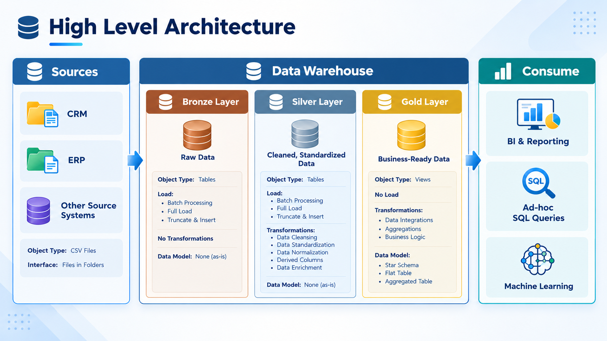
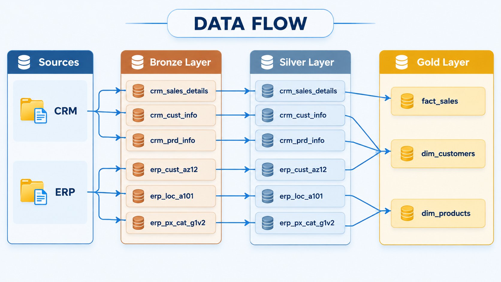

# 🏢 Modern Data Warehouse & Analytics Project

An end-to-end data project built with **SQL Server**: I designed a data warehouse that consolidates sales data from two source systems (**CRM** and **ERP**) into a clean **star schema** using the **Medallion Architecture** (Bronze → Silver → Gold), then used it to run **Exploratory Data Analysis and advanced SQL analytics** that uncover insights about customers, products, and sales.

---


## 📖 Project Overview

Companies often keep their data scattered across multiple systems, in inconsistent formats and with quality issues, which makes reliable reporting hard.

This project covers the **full data journey**, from raw files to business insights, in two parts:

### 🏗️ Part 1: Data Engineering (Building the Data Warehouse)

1. **Ingests** raw CSV data from two source systems (CRM & ERP)
2. **Cleans and standardizes** the data to fix quality issues
3. **Integrates** both sources into one unified, business-friendly star schema

### 📊 Part 2: Data Analysis (Analytics & Reporting)

4. **Explores** the data (EDA) to understand its structure, ranges, and key measures
5. **Analyzes** trends, rankings, and segments using advanced SQL (window functions, CTEs)
6. **Delivers** customer and product reports plus business insights for decision-making

---

## 🎯 Business Problem

Stakeholders needed a single source of truth to answer questions such as:

- Who are our customers and how do they behave?
- Which products perform best?
- How are sales trending over time?

The warehouse provides the clean, integrated foundation, and the **data analysis** on top of it turns that data into answers.

---

## 🏗️ Data Architecture

The warehouse follows the **Medallion Architecture** with three layers:



| Layer | Purpose | Details |
|-------|---------|---------|
| 🥉 **Bronze** | Raw data | Data loaded as it is from CSV files into SQL Server (full load, truncate & insert) |
| 🥈 **Silver** | Cleaned data | Data cleaning, standardization, and normalization |
| 🥇 **Gold** | Business-ready data | Integrated **star schema** (views) optimized for reporting & analytics |

---

## 📂 Data Sources

Six CSV files from two source systems:

| System | Files | Content |
|--------|-------|---------|
| **CRM** | `cust_info`, `prd_info`, `sales_details` | Customer, product, and sales transaction data |
| **ERP** | `CUST_AZ12`, `LOC_A101`, `PX_CAT_G1V2` | Customer demographics, locations, and product categories |

---

## 🔄 ETL Pipeline



### 🥉 Bronze Layer: Extract & Load
- Created the database and schemas (`bronze`, `silver`, `gold`)
- Loaded raw CSV files using `BULK INSERT`
- Wrapped the load in a **stored procedure** with logging and error handling 

### 🥈 Silver Layer: Clean & Transform
Typical data quality fixes applied:

- Removing **duplicates** and keeping the latest record per key
- Trimming **unwanted spaces**
- Handling **NULLs** and invalid values
- **Standardizing** coded values into readable ones (e.g. gender, marital status, country)
- Fixing **invalid dates** and converting data types
- Recalculating inconsistent **sales, price, and quantity** values
- Deriving new columns

### 🥇 Gold Layer: Model & Serve
- Joined CRM and ERP data into unified business entities
- Built **dimension and fact views** following the star schema
- Created surrogate keys and friendly column names

---


## 📚 Data Catalog (Gold Layer)

The Gold Layer is the business-level data representation, structured to support analytical and reporting use cases. It consists of **dimension tables** and **fact tables** for specific business metrics.

### 1. `gold.dim_customers`
- **Purpose:** Stores customer details enriched with demographic and geographic data.

| Column Name      | Data Type     | Description                                                                                   |
|------------------|---------------|-----------------------------------------------------------------------------------------------|
| customer_key     | INT           | Surrogate key uniquely identifying each customer record in the dimension table.               |
| customer_id      | INT           | Unique numerical identifier assigned to each customer.                                        |
| customer_number  | NVARCHAR(50)  | Alphanumeric identifier representing the customer, used for tracking and referencing.         |
| first_name       | NVARCHAR(50)  | The customer's first name, as recorded in the system.                                         |
| last_name        | NVARCHAR(50)  | The customer's last name or family name.                                                     |
| country          | NVARCHAR(50)  | The country of residence for the customer (e.g., 'Australia').                               |
| marital_status   | NVARCHAR(50)  | The marital status of the customer (e.g., 'Married', 'Single').                              |
| gender           | NVARCHAR(50)  | The gender of the customer (e.g., 'Male', 'Female', 'n/a').                                  |
| birthdate        | DATE          | The date of birth of the customer, formatted as YYYY-MM-DD (e.g., 1971-10-06).               |
| create_date      | DATE          | The date and time when the customer record was created in the system|

### 2. `gold.dim_products`
- **Purpose:** Provides information about the products and their attributes.

| Column Name         | Data Type     | Description                                                                                   |
|---------------------|---------------|-----------------------------------------------------------------------------------------------|
| product_key         | INT           | Surrogate key uniquely identifying each product record in the product dimension table.         |
| product_id          | INT           | A unique identifier assigned to the product for internal tracking and referencing.            |
| product_number      | NVARCHAR(50)  | A structured alphanumeric code representing the product, often used for categorization or inventory. |
| product_name        | NVARCHAR(50)  | Descriptive name of the product, including key details such as type, color, and size.         |
| category_id         | NVARCHAR(50)  | A unique identifier for the product's category, linking to its high-level classification.     |
| category            | NVARCHAR(50)  | The broader classification of the product (e.g., Bikes, Components) to group related items.  |
| subcategory         | NVARCHAR(50)  | A more detailed classification of the product within the category, such as product type.      |
| maintenance         | NVARCHAR(50)  | Indicates whether the product requires maintenance (e.g., 'Yes', 'No').                       |
| cost                | INT           | The cost or base price of the product, measured in monetary units.                            |
| product_line        | NVARCHAR(50)  | The specific product line or series to which the product belongs (e.g., Road, Mountain).      |
| start_date          | DATE          | The date when the product became available for sale or use, stored in|

### 3. `gold.fact_sales`
- **Purpose:** Stores transactional sales data for analytical purposes.

| Column Name     | Data Type     | Description                                                                                   |
|-----------------|---------------|-----------------------------------------------------------------------------------------------|
| order_number    | NVARCHAR(50)  | A unique alphanumeric identifier for each sales order (e.g., 'SO54496').                      |
| product_key     | INT           | Surrogate key linking the order to the product dimension table.                               |
| customer_key    | INT           | Surrogate key linking the order to the customer dimension table.                              |
| order_date      | DATE          | The date when the order was placed.                                                           |
| shipping_date   | DATE          | The date when the order was shipped to the customer.                                          |
| due_date        | DATE          | The date when the order payment was due.                                                      |
| sales_amount    | INT           | The total monetary value of the sale for the line item, in whole currency units (e.g., 25).   |
| quantity        | INT           | The number of units of the product ordered for the line item (e.g., 1).                       |
| price           | INT           | The price per unit of the product for the line item, in whole currency units (e.g., 25).      |

---


## ✅ Data Quality & Testing

Quality checks were written to validate the Silver and Gold layers, including:

- Uniqueness of primary / surrogate keys
- No unwanted spaces in string columns
- Data standardization & consistency
- Valid date ranges and order
- Consistency between sales, quantity, and price
- Integrity of fact-to-dimension relationships

---

## 📊 Analytics & Insights

SQL-based analytics built on top of the Gold layer, covering:

- **Customer Behavior:** segmentation and purchasing patterns
- **Product Performance:** top and bottom performing products and categories
- **Sales Trends:** growth over time and key business metrics

---

## 📁 Repository Structure

```
data-warehouse-project/
│
├── datasets/               # Source CSV files (CRM & ERP)
│
├── docs/                   # Architecture, data model, data flow & naming conventions
│
├── scripts/
│   ├── init_database.sql   # Database & schemas creation
│   ├── bronze/             # Raw data ingestion
│   ├── silver/             # Cleaning & transformation
│   └── gold/               # Star schema views
│
├── tests/                  # Data quality checks
│
├── LICENSE
└── README.md
```

---

## 🚀 Getting Started

### Prerequisites
- [SQL Server Express](https://www.microsoft.com/en-us/sql-server/sql-server-downloads)
- [SQL Server Management Studio (SSMS)](https://learn.microsoft.com/en-us/sql/ssms/download-sql-server-management-studio-ssms)

### Steps

1. **Clone the repository**
   ```bash
   git clone https://github.com/<your-username>/<your-repo-name>.git
   ```
2. **Update the file paths** inside the bronze load script to point to the `datasets/` folder on your machine
3. **Run the scripts in this order:**
   ```text
   1. scripts/init_database.sql
   2. scripts/bronze/   (create tables + load procedure)
   3. scripts/silver/   (create tables + load procedure)
   4. scripts/gold/     (create views)
   ```
4. **Execute the load procedures**
   ```sql
   EXEC bronze.load_bronze;
   EXEC silver.load_silver;
   ```
5. **Run the data quality checks** in `tests/` and query the `gold` views

---

## 💡 Key Skills Demonstrated

- Designing a layered **data warehouse architecture**
- Building **ETL pipelines** with stored procedures, logging, and error handling
- **Data cleansing** and quality validation
- **Dimensional modeling** (fact & dimension tables, surrogate keys)
- Writing **analytical SQL** (CTEs, window functions, aggregations)
- **Documenting** data models and pipelines for technical and business audiences

---

## 🙏 Acknowledgements

This project was built while following the data warehouse course by **[Baraa Khatib Salkini (Data With Baraa)](https://github.com/DataWithBaraa/sql-data-warehouse-project)**, released under the MIT License. Thank you for the excellent teaching material.

---
